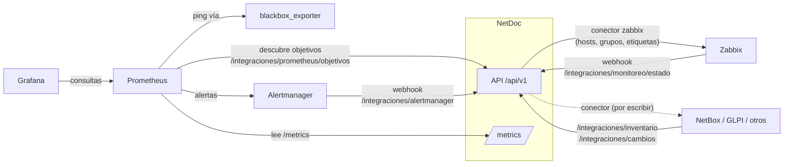

# Integraciones y escalabilidad

NetDoc es la **fuente de verdad del inventario físico** de la red: qué hay,
dónde está y cómo se conecta. Las herramientas de monitoreo le informan el
**estado** de cada elemento, y los otros inventarios pueden leer lo
documentado o sincronizarse con él. Este documento describe los puntos de
integración que ya existen y cómo sumar otros.

> Es la referencia técnica. Para **operar** el monitoreo (instalar, configurar
> y usar Prometheus, Grafana y Zabbix paso a paso) está el
> [manual de monitoreo](manual-monitoreo.md); para cargar un edificio, la
> [guía para incorporar un edificio](guia-nuevo-edificio.md).



## Principios

- **Contratos estables.** El inventario se publica con el esquema versionado
  `netdoc.inventario/v1`; la base puede cambiar sin romper a quien lo consume.
- **Ids externos.** `identificador_externo` guarda el id que cada sistema le
  asignó a un elemento, para sincronizar sin duplicar y para traducir los
  eventos que llegan de vuelta.
- **Incremental.** El registro de cambios (`/integraciones/cambios`) y
  `modificado_desde` evitan releer el inventario completo en cada pasada.
- **Planificar antes de aplicar.** Los conectores muestran qué harían y solo
  lo ejecutan con `--aplicar`.
- **Cada sistema administra lo suyo.** El conector de Zabbix solo toca sus
  grupos `NetDoc/…` y sus etiquetas `netdoc_*`.

## Monitoreo activo

### Prometheus y Grafana

| Pieza | Qué hace |
|---|---|
| `GET /metrics` | Métricas de inventario (ver abajo), latencia de la API por ruta y métricas del proceso |
| `GET /api/v1/integraciones/prometheus/objetivos` | Descubrimiento HTTP (`http_sd_configs`): un objetivo por elemento con IP, con etiquetas `netdoc_codigo`, `netdoc_tipo`, `netdoc_edificio`, `netdoc_piso`, `netdoc_tramo` y `netdoc_criticidad`. Admite `?edificio=` y `?tipo=` |
| `POST /api/v1/integraciones/alertmanager` | Webhook de Alertmanager: una alerta activa deja el elemento "en falla" y una resuelta, "activo" |
| `deploy/prometheus/` | `prometheus.yml` (lee NetDoc y hace ping con blackbox a lo que descubre), `reglas.yml`, `blackbox.yml` |
| `deploy/alertmanager/` | Solo las alertas `netdoc="disponibilidad"` van a NetDoc |
| `deploy/grafana/` | Origen de datos y el panel "NetDoc — Inventario y estado" |

Métricas de inventario:

| Métrica | Etiquetas | Valor |
|---|---|---|
| `netdoc_elementos` | edificio, piso, tipo, estado_operativo | cantidad |
| `netdoc_elemento_estado` | codigo, tipo, edificio, piso, tramo | 0 activo, 1 en mantenimiento, 2 inactivo, 3 en falla |
| `netdoc_completitud_porcentaje` | edificio | promedio de la completitud de fichas (SOP §9) |
| `netdoc_elementos_sin_ubicar` | edificio, piso | con marcador propio y sin posición |
| `netdoc_ultimo_cambio_timestamp_seconds` | — | último cambio del historial |
| `netdoc_base_datos_disponible` | — | 1 / 0 |

Para levantar todo con Docker:

```bash
# .env en la raíz: NETDOC_MONITOREO_TOKEN=<token> y NETDOC_GRAFANA_CLAVE=<clave>
NETDOC_API_HOST=0.0.0.0 ./iniciar.sh      # por HTTPS; genera backend/certs/netdoc.crt
docker compose --profile monitoreo up -d  # toma de .env el token y la clave
# En el servidor: Prometheus :9090 · Alertmanager :9093 · Grafana :3000 (carpeta NetDoc)
```

El ciclo se probó con los binarios oficiales (Prometheus 3.14, Alertmanager
0.34, blackbox_exporter 0.28) contra una copia de la base: Prometheus
descubrió los objetivos desde el inventario, blackbox detectó la IP que no
respondía, la alerta pasó por Alertmanager y el elemento quedó "en falla" con
el motivo en su historial. Las once consultas del panel de Grafana devolvieron
datos. La configuración se validó con `promtool` y `amtool`.

Esa prueba es anterior a que NetDoc exigiera HTTPS y token en las lecturas. La
configuración actual (`credentials_file`, `tls_config`) se comprobó reproduciendo
con `curl` esas mismas peticiones contra NetDoc, no con esos binarios ni con Docker:
al levantarlo por primera vez, revise *Status → Target health* (sección A.4 del
[manual](manual-monitoreo.md)).

El `for` de la regla `NetDocElementoSinRespuesta` (10 minutos) cumple el papel
del umbral del SOP §11.3.

### Zabbix

- **Zabbix → NetDoc:** tipo de medio Webhook con
  [`deploy/zabbix/netdoc-webhook.js`](../deploy/zabbix/netdoc-webhook.js).
  Reconoce el elemento por el nombre del host (su código) o por su IP. Un host que aún
  tenga el código anterior de un elemento trasladado también lo encuentra.
- **NetDoc → Zabbix:** `python -m app.scripts.sincronizar zabbix [--edificio ING] [--aplicar]`
  crea y actualiza un host por elemento con IP de gestión. Si el elemento se trasladó,
  renombra su host con el código nuevo en vez de crear otro; lo reconoce por el id que
  guardó al crearlo.

Instrucciones paso a paso en el [manual de monitoreo](manual-monitoreo.md#opción-b-zabbix)
y en [`deploy/zabbix/README.md`](../deploy/zabbix/README.md).

## Otros inventarios (NetBox, GLPI u otros)

Las consultas bajo `/api/v1/integraciones/` se autentican con
`Authorization: Bearer <NETDOC_MONITOREO_TOKEN>` y, desde otro equipo, por HTTPS.
Registrar o quitar un id externo (`/api/v1/elementos/…/externos/…`) exige la sesión
del administrador (`POST /api/v1/auth/ingresar`).

| Endpoint | Uso |
|---|---|
| `GET /api/v1/integraciones/inventario` | Exportación con el esquema `netdoc.inventario/v1`, en JSON (`formato=json`) o CSV (`formato=csv`). Filtros `edificio`, `tipo`, `modificado_desde`, `incluir_bajas`; paginada con `limite` y `desplazamiento` |
| `GET /api/v1/integraciones/cambios?desde=<id>` | Cambios posteriores a `desde`, en orden; se guarda `ultimo_id` y se sigue mientras `hay_mas` |
| `PUT /api/v1/elementos/{codigo}/externos/{sistema}` | Registra el id del elemento en otro sistema (`{"id_externo": "481", "url": "…"}`) |
| `DELETE /api/v1/elementos/{codigo}/externos/{sistema}` | Lo quita |
| `GET /api/v1/integraciones/externos/{sistema}/{id}` | El elemento que otro sistema conoce por ese id |

Cada registro del inventario trae la ubicación completa (edificio, piso,
tramo, lámina, recinto, rack y unidad), la posición en el plano (la del rack
para lo montado), los datos de red y de equipo, la ficha del tipo, la
completitud y los ids externos.

### Correspondencia de conceptos

| NetDoc | NetBox | GLPI 10 |
|---|---|---|
| Edificio | Site | Lugar (primer nivel) |
| Piso, tramo | Location anidada | Lugar hijo |
| Rack (`R`) | Rack | Rack |
| Equipo montado + unidad de rack | Device con `rack`, `position`, `face` | Equipo de red + posición en el rack |
| Tipo de elemento | Device role | Tipo de activo (equipo de red, periférico…) |
| Marca / modelo | Manufacturer / Device type | Fabricante / Modelo |
| Código del SOP | `name` o campo personalizado `netdoc_codigo` | Nombre |
| N° de serie | `serial` | N° de serie |
| IP de gestión | Primary IP (IPAM) | Dirección IP de un puerto de red |
| MAC | MAC de la interfaz | MAC del puerto de red |
| Estado operativo | `status`: activo → active, inactivo → offline, en falla → failed, retirado → decommissioning | Estado |
| Punto de datos (`PD`) | Front port del patch panel + cable | Toma (Socket) |
| Enlace | Cable | Cable |
| VLAN | VLAN (IPAM) | VLAN |

### Escribir un conector

1. Crear `app/integraciones/<sistema>.py` con una subclase de
   `app.integraciones.base.Conector`:
   - `sistema`: el nombre corto con que se guardan sus ids;
   - `seleccionar(elementos)`: los que le interesan a ese sistema;
   - `planificar(elementos)`: compara y devuelve acciones `crear`,
     `actualizar` o `sin_cambios`, **sin modificar nada**;
   - `aplicar(accion)`: la ejecuta y devuelve el id externo.
2. Registrarlo en `CONECTORES` de `app/integraciones/__init__.py`.
3. Sus parámetros de conexión van en `app/core/config.py` como
   `NETDOC_<SISTEMA>_*`.
4. Probarlo con una API simulada, como `tests/test_conector_zabbix.py`.

`python -m app.scripts.sincronizar <sistema>` ya se encarga de recorrer los
elementos, mostrar el plan, aplicarlo con `--aplicar` y guardar los ids.

## Escalabilidad

- **Esquema versionado.** Las migraciones de Alembic (`backend/alembic/versions`)
  crean y actualizan el esquema igual en SQLite que en PostgreSQL;
  `python -m app.scripts.migrar` las aplica (lo hace `iniciar.sh` al arrancar).
  Para cambiar el modelo: editar `app/models`,
  `alembic revision --autogenerate -m "<qué cambia>"`, revisar la migración y
  correr `migrar`. La prueba `test_migraciones` falla si un modelo cambia sin
  su migración.
- **PostgreSQL.** `instalar-servidor.sh --base postgresql` lo deja listo en un
  servidor ([guía](instalacion-servidor.md)). En un equipo propio,
  `docker compose --profile postgres up -d db` y
  `NETDOC_DATABASE_URL=postgresql+psycopg://…`; `migrar` crea el esquema y
  `app.scripts.copiar_base` pasa los datos desde SQLite.
- **Varios procesos.** La API no guarda estado en memoria (las sesiones y los
  intentos de ingreso están en la base), así que admite `uvicorn --workers N` o
  varios contenedores detrás de un balanceador. Las
  métricas HTTP son por proceso; para sumarlas se usa el modo multiproceso de
  `prometheus_client` (`PROMETHEUS_MULTIPROC_DIR`). Las de inventario salen de
  la base y son iguales desde cualquier proceso.
- **Consultas acotadas.** Los listados y la exportación están paginados; el
  plano se pide por piso o tramo.
- **Seguridad.** Toda la API, los planos y las fotografías exigen la sesión del
  único administrador; los sistemas externos usan `NETDOC_MONITOREO_TOKEN`; hacia la
  red solo se atiende por HTTPS. Ver [seguridad.md](seguridad.md). El paso natural
  siguiente es integrar el directorio de la UMAG (LDAP u OIDC).

## Variables de configuración

| Variable | Uso |
|---|---|
| `NETDOC_DATABASE_URL` | Base de datos (SQLite por omisión) |
| `NETDOC_ADMIN_USUARIO`, `NETDOC_ADMIN_CLAVE_HASH` | Usuario administrador y hash de su contraseña, que escribe `app.scripts.definir_clave` |
| `NETDOC_INGRESO_INTENTOS`, `NETDOC_INGRESO_INTENTOS_GLOBALES`, `NETDOC_INGRESO_BLOQUEO_MINUTOS` | Intentos fallidos por equipo (3) y entre todos (30), y minutos que cuenta cada uno (15) |
| `NETDOC_SESION_HORAS`, `NETDOC_SESION_INACTIVIDAD_MINUTOS` | Duración máxima de una sesión (12) y sin actividad (30) |
| `NETDOC_CARGA_MAX_MB` | Tamaño máximo de un plano o fotografía que se carga por la API (100) |
| `NETDOC_MONITOREO_TOKEN` | Token de los webhooks de Zabbix y Alertmanager y de las lecturas de `/metrics` y `/api/v1/integraciones/`; vacío los deshabilita |
| `NETDOC_MONITOREO_MINUTOS_FALLA` | Umbral de caída cuando el evento informa los minutos |
| `NETDOC_ZABBIX_URL`, `NETDOC_ZABBIX_TOKEN` | API de Zabbix para el conector |
| `NETDOC_ZABBIX_GRUPO_RAIZ`, `NETDOC_ZABBIX_TIPOS`, `NETDOC_ZABBIX_PLANTILLAS`, `NETDOC_ZABBIX_COMUNIDAD_SNMP` | Qué y cómo se crea en Zabbix |
| `NETDOC_API_HOST` | Interfaz donde escucha `iniciar.sh`; fuera de este equipo, solo por HTTPS (`0.0.0.0` para el perfil de monitoreo) |
| `NETDOC_PROXY_CONFIABLE` | IP de un proxy propio en `iniciar.sh`, del que se cree lo que informa sobre el cliente |
| `NETDOC_GRAFANA_CLAVE`, `NETDOC_POSTGRES_CLAVE` | Claves de `docker-compose.yml`, sin valor por omisión |
