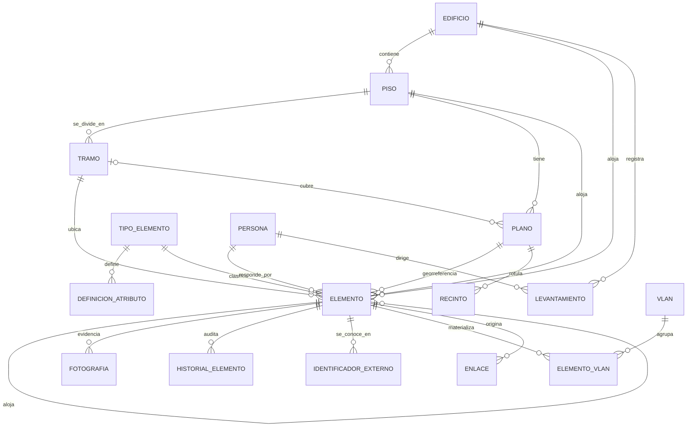

# Modelo de datos

Corresponde al objetivo específico 2 de la propuesta de memoria: *"Diseñar el
modelo de datos que soporte dichos atributos y sea extensible a nuevos tipos de
elementos"*.

## Diagrama



El diagrama completo, con columnas, tipos, índices y reglas de borrado, está
en [`modelo-datos.dbml`](modelo-datos.dbml). Para verlo, abrir
[dbdiagram.io](https://dbdiagram.io), entrar al editor (*Create your diagram*)
y pegar el contenido en el panel izquierdo. El archivo se genera desde los
modelos. Después de cambiar el esquema se regenera, y las pruebas fallan si
quedó desactualizado:

```bash
cd backend
.venv/bin/python -m app.scripts.exportar_dbml -o ../docs/modelo-datos.dbml
```

## Las tres decisiones estructurales

### 1. Atributos híbridos: columnas + JSON dirigido por catálogo

El SOP distingue dos conjuntos de atributos y el modelo los trata distinto:

| | Atributos comunes (SOP §9.1) | Ficha específica (SOP §9.2) |
|---|---|---|
| Dónde viven | Columnas de `elemento` | `elemento.atributos` (JSON) |
| Por qué | Se filtran, ordenan e indexan en cada consulta | Cambian por tipo y evolucionan |
| Quién los valida | El propio esquema de la tabla | `definicion_atributo` + `servicios/validacion.py` |

`definicion_atributo` actúa como **esquema de datos almacenado como datos**:
declara clave, etiqueta, tipo de dato, obligatoriedad, opciones y unidad de
cada campo de la ficha. Con eso:

- el backend valida la carga sin conocer los tipos de antemano;
- el reporte de completitud sabe qué es obligatorio para cada tipo;
- el panel de detalle del visor rotula los campos sin tener nada codificado.

Incorporar un tipo nuevo es un `POST /api/v1/catalogo/tipos`. No hay migración
de esquema, ni despliegue de backend, ni cambio en el frontend.

El costo de la decisión: los atributos de ficha no se pueden indexar ni
consultar con la misma eficiencia que una columna. Si alguno pasa a ser
transversal y consultado con frecuencia (ocurrió con `direccion_ip`), la salida
es promoverlo a columna en una migración.

### 2. Anidamiento por contención

`elemento.padre_id` apunta a otro elemento. Resuelve el punto 20 de la sección
10.3 del SOP: varios elementos comparten una coordenada del plano, así que el
contenedor lleva el marcador y los demás cuelgan de él. Solo los tipos con
`es_contenedor = true` pueden ser padres.

En el CADI el contenedor es el rack (`R`): aloja switches, routers, patch
panels, ODF, servidores y PBX (10 racks). El rack lleva el marcador y, al
seleccionarlo, el visor despliega su vista frontal con los equipos montados.

Los puntos de datos (`PD`) no tienen contenedor: cada uno es una fila de la
planilla, con su propio marcador, y el recinto donde está queda como ubicación
descriptiva.

**Montado o conectado.** Lo montado dentro de su contenedor no se ubica por
separado: la API rechaza darle coordenadas propias, el visor lo dibuja a través
del marcador del contenedor y su completitud toma las coordenadas de este
(`Elemento.representante_en_plano`). Las planillas, sin embargo, anotan en la
columna *Rack* también el rack al que se **conecta** un AP o una UPS de torre,
que están en otro lugar. Esos tipos (`TIPOS_CONECTADOS_AL_CONTENEDOR`) conservan
el `padre_id`, pero se ubican por su cuenta y la ficha del rack los lista como
"conectados".

Una versión anterior agrupaba los puntos de datos de un mismo recinto bajo un
tipo `FP` (*faceplate*), tomando como elemento la "roseta" de la primera
columna de la planilla. Se eliminó: `FP` no existe en el SOP §8.4 y, para la
DSI, la roseta **es** el punto de datos.

### 3. Historial campo a campo

Cada modificación deja una fila en `historial_elemento` con el campo, el valor
anterior, el valor nuevo y el **origen** (`manual`, `monitoreo`, `importacion`,
`sistema`). El origen es lo que permite distinguir un cambio hecho por un
técnico de una sincronización automática de Zabbix, y es la base del registro
de retención permanente que exige la sección 12 del SOP.

## Tablas

### Territorio

| Tabla | Rol |
|---|---|
| `edificio` | Catálogo del SOP §8.2. `codigo` es la sigla que abre todo código de elemento |
| `piso` | `P00`…`PXX` (SOP §8.3), con `orden` para la navegación |
| `tramo` | Subdivisión horizontal del piso (`T1`, `T2`…), usada en el código |
| `plano` | Imagen base del piso o de uno de sus tramos (`tramo_id` nulo = piso completo). `ancho_px` y `alto_px` definen el sistema de coordenadas. Solo uno vigente por piso–tramo; los anteriores quedan como histórico |
| `recinto` | Sala rotulada en una lámina: su número, su nombre y el punto donde se ubican sus elementos. Pertenece a una versión del plano (ver [Ubicación por recinto](#ubicación-por-recinto)) |
| `persona` | Responsables (SOP §4) |
| `levantamiento` | Bitácora por edificio (SOP §10.5 punto 24) |

### Catálogo

| Tabla | Rol |
|---|---|
| `tipo_elemento` | Taxonomía del SOP §7.2 con su código del §8.4, categoría, color e íconos, y las banderas `es_contenedor` y `usa_correlativo` |
| `definicion_atributo` | Esquema de la ficha de cada tipo (SOP §9.2) |

### Elementos

| Tabla | Rol |
|---|---|
| `elemento` | Unidad documentada. Identificación, ubicación (con el `numero_recinto` de su sala), coordenadas, estado, identidad de red, trazabilidad y ficha JSON |
| `fotografia` | Evidencia (SOP §10.4), nombrada `<código>_<n>.<ext>` |
| `historial_elemento` | Bitácora campo a campo |

### Lógica y conectividad

| Tabla | Rol |
|---|---|
| `vlan` | VLAN y subred (SOP §7.1, categoría lógica). El número es único **por edificio**: la VLAN 3 del CADI y la de otro edificio son registros distintos |
| `elemento_vlan` | Qué elemento materializa qué VLAN y en qué rol |
| `identificador_externo` | Id del elemento en otro sistema (NetBox, GLPI, Zabbix…): uno por sistema y elemento. Lo usan los conectores para sincronizar sin duplicar ([integraciones](integraciones.md)) |
| `enlace` | Conexión física. Cubre tanto el uplink de un switch (§9.2.1) como el mapeo puerto de patch panel → punto de datos (§9.2.3). `destino_descripcion` permite registrar el destino como texto mientras no exista como elemento documentado |

### Acceso

| Tabla | Rol |
|---|---|
| `sesion_acceso` | Sesiones del administrador: la huella del token de la cookie, de dónde se inició, último uso y vencimiento. Borrar la fila cierra la sesión ([seguridad](seguridad.md)) |
| `intento_ingreso` | Intentos de ingreso fallidos de la última ventana, por equipo: es lo que limita los intentos, también con varios procesos y tras un reinicio |

## Enumeraciones

Se almacenan como `VARCHAR` con restricción `CHECK`, no como tipos nativos de
PostgreSQL. Agregar un valor a la taxonomía es entonces una migración simple en
ambos motores, sin el ciclo de `CREATE TYPE` / `ALTER TYPE`.

| Enumeración | Valores |
|---|---|
| `categoria_elemento` | activo, pasivo, soporte, logico |
| `estado_operativo` | activo, inactivo, en_falla, en_mantenimiento, retirado |
| `estado_condicion` | excelente, regular, malo, obsoleto |
| `criticidad` | alta, media, baja |
| `tipo_dato` | texto, numero, booleano, fecha, enum, ip, mac, lista, referencia |
| `origen_cambio` | manual, monitoreo, importacion, sistema |
| `medio_enlace` | cobre, fibra, inalambrico |

## Coordenadas sobre el plano

`elemento.pos_x` y `pos_y` se expresan en las unidades declaradas por el plano
(`ancho_px` × `alto_px`), con el origen en la **esquina superior izquierda**,
que es como se numeran los planos.

Leaflet mide la latitud hacia arriba, así que el visor convierte en el borde:

```
latlng = (-y, x)
```

La esquina superior izquierda del plano queda en el origen y la lámina ocupa
latitudes negativas. Así la grilla de teselas de Leaflet, que parte del
origen, coincide con la de la pirámide de teselas de la lámina (ver
[Teselas](#teselas)).

La conversión vive únicamente en `frontend/src/components/VisorPlano.tsx`
(`aLatLng` / `aCoordenadas`). El backend almacena siempre coordenadas de plano,
nunca coordenadas de Leaflet: si mañana el visor cambia a Konva o a SVG, los
datos siguen siendo válidos.

### Teselas

Las láminas de CAD traen cientos de miles de trazos (las del CADI, hasta
180 000 en 30 MB). Como imagen única, el navegador vuelve a dibujarlos todos
cada vez que necesita un pedazo nuevo del plano, y el visor se arrastra al
moverlo. Por eso cada plano vigente se pre-dibuja una vez, como un mapa web,
en una pirámide de teselas WebP de 256×256 (`app/servicios/teselas.py`, con
libvips):

- En el nivel `z` del visor, una unidad del plano mide `2^z` píxeles. El nivel
  más detallado de la pirámide se elige para que la lámina mida unos 12 000
  px de ancho: `z = 2` en las del CADI, que deja legibles los rótulos de los
  puntos de datos. El visor permite acercarse un nivel más, con las teselas
  al doble.
- Se guardan en `media/teselas/<archivo del plano>/{z}/{y}/{x}.webp` con
  `teselas.json`. La API las entrega en `plano.teselas` (nulo mientras no
  existan, y el visor muestra entonces la lámina original).
- Las genera `cargar_planos`, al iniciar el sistema, para todo plano vigente
  que no las tenga, y la API en segundo plano tras subir un plano. Cada
  lámina se dibuja en un proceso aparte: con las del CADI toma de 5 a 20 s y
  hasta ~1 GB de memoria, que se libera al terminar. Con `NETDOC_TESELAS=0`
  no se generan.

Con las teselas, un arrastre sobre la lámina más pesada del CADI pasó de
2,3 s de dibujo en el navegador a 15 ms, y de cuadros de hasta 133 ms a 17 ms.

### Láminas por tramo

La DSI dibuja los pisos grandes del CADI en una lámina por tramo (el Piso 1 en
tres, los pisos 2 y 3 en dos), y cada lámina tiene su propio sistema de
coordenadas. Por eso un plano puede cubrir el piso completo o un solo tramo, y
la posición de un elemento solo se dibuja sobre la lámina del mismo
piso–tramo en que se fijó. Un tramo sin lámina propia se ve sobre el plano del
piso completo, como el Piso 4.

El tramo del código y la lámina donde está dibujado un elemento no siempre
coinciden. En el Piso 1, la sala eléctrica de los racks se considera tramo 3, así
que los racks y los puntos de datos que llegan a ellos llevan T3 en el rótulo,
pero están dibujados en la lámina del tramo 1: la del tramo 3 solo muestra el
auditorio. Por eso `elemento.tramo_lamina_id` guarda, cuando hace falta, el
tramo de la lámina que lo muestra (nulo = la de su propio tramo). Lo montado
sigue la lámina de su rack. La vista de un tramo muestra lo dibujado en su
lámina, el backend rechaza ubicar un elemento sobre otra lámina, y la ficha del
visor permite cambiarla; al hacerlo se borra la posición anterior, que era
sobre la otra lámina.

### Versiones de una lámina

Una lámina nueva para un piso–tramo que ya tiene plano no reemplaza el
registro: se agrega un `plano` vigente y el anterior queda con
`vigente = false`, con su archivo. Las posiciones pasan a la versión nueva solo
si `ancho_px` × `alto_px` no cambió. Si cambió, las coordenadas no tienen
equivalente seguro en el dibujo nuevo y el elemento queda sin ubicar, con su
posición anterior en `historial_elemento` (origen `sistema` si lo hizo
`cargar_planos`, `manual` si fue una carga por la API).

**Grupos de puntos de datos.** Los puntos de datos con exactamente la misma
posición forman un grupo: un solo marcador con cuántos son y una sola fila en
el listado. Al ubicar un punto de datos, un clic sobre otro ya ubicado toma su
posición exacta. El grupo no se guarda: se deriva de las coordenadas, así que
mover un punto de datos lo saca del grupo.

Se optó por coordenadas simples y no por PostGIS porque un plano de piso no
tiene sistema de referencia geográfico y la única operación espacial requerida
es "dibujar un punto donde el usuario hizo clic".

## Ubicación por recinto

Cada sala de los planos de la DSI lleva su número bajo el nombre
(`SALA 1` / `0021`), y el número dice el piso: los del subterráneo empiezan con
`00`, los del primer piso con `1`, los del segundo con `2`, y así. Las planillas
anotan ese mismo número en la ubicación de cada elemento («Oficina 1083»), así
que el sistema puede dibujar cada elemento en su sala sin que nadie haga clic.

**`elemento.numero_recinto`.** El número de la sala donde está, separado del
texto de la ubicación. El importador lo toma de la ubicación, y solo si es del
piso del elemento: en «Oficina 1039/2018» del primer piso es 1039, y
«Box Fisiopatología 2022» en el tercer piso no tiene número (2022 es del
segundo: el importador lo informa como error de transcripción). En el visor se
completa o corrige en la ficha (*Editar → N° de recinto*); al guardarlo, el
elemento pasa a ese recinto.

**`recinto`.** Las láminas de CAD traen el texto convertido en trazos, así que
los números se leen como imagen: `app.scripts.extraer_recintos` dibuja cada
lámina y la pasa por un OCR. Lo leído queda en `data/<código>/<código>-recintos.csv`
(lámina, número, nombre, x, y, huella), que se revisa y versiona como una
planilla más, y al cargar las láminas se copia a esta tabla. `pos_x` y `pos_y`
no son el rótulo, sino el punto justo bajo el número donde se dibujan los
marcadores.

Cada recinto pertenece a una **versión** del plano: la huella del CSV
(`sha256` de la lámina tal como se guarda) debe coincidir con la del plano
vigente. Si la lámina cambia, sus recintos no se cargan hasta volver a leerla:
con otro dibujo los números podrían estar en otro lugar.

**Cómo se ubica** (`app/servicios/recintos.py`). Al cargar láminas o importar,
cada elemento que aún no tiene posición se busca por su número, primero en la
lámina donde se dibuja y después en las demás del piso. Así se resuelve solo el
caso de la sala eléctrica del Piso 1, rotulada en el tramo 3 pero dibujada en
la lámina del tramo 1: el elemento queda en la lámina donde está su sala. Una
subdivisión sin rótulo propio (`1083.2`) cae en su sala (`1083`).

- Los **puntos de datos** de una sala quedan todos en el mismo punto, y el
  visor los agrupa en un marcador con el total que se despliega (los
  *grupos de puntos de datos* descritos más arriba). Uno que llega después
  se suma al grupo de su sala, aunque el recinto se haya vuelto a leer.
- Un **rack** rotulado en la lámina («RACK 08») va sobre su rótulo: ubica el
  rack aunque su sala no tenga número, como las salas eléctricas del CADI.
- Los **demás equipos** se reparten alrededor, a 1/350 del ancho de la lámina
  uno del otro: primero a los lados y después más abajo, lejos del rótulo.
- Lo **montado** en un rack no se ubica: se ve donde esté el rack.
- Lo que no tiene recinto en la lámina pero la planilla pone en la **misma
  sala** que un elemento ya ubicado (el AP o la UPS de una sala eléctrica)
  queda junto a él, de preferencia junto al rack.
- Lo que **ya tiene posición** no se toca, la haya puesto el sistema o una
  persona. *Ubicar en su recinto*, en la ficha, lo devuelve a su sala.

Lo que no se pudo ubicar se lista al cargar: elementos sin número de recinto
y números que no aparecen en las láminas de su piso, con el recinto de nombre
más parecido como sugerencia («Recepción 1063» → `1082` SECRETARÍA RECEPCIÓN).
La sugerencia nunca se aplica sola.
